<div style="text-align: center;">
  <a href="Dynamic_Expected_Loss_Optimization_in_Credit_Risk_Arain_2026.pdf">
    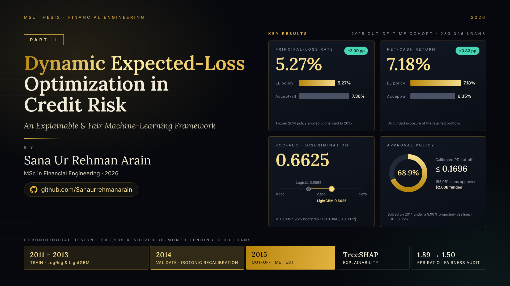
  </a>
  <p><em>Click the banner above to open the full thesis (PDF)</em></p>
</div>

<h1>Dynamic Expected-Loss Optimization in Credit Risk</h1>
<h3>An Explainable &amp; Fair Machine-Learning Framework — Part II</h3>

<p>
  
  
  
  
  
  
  
  
</p>

<p><strong>603,589 resolved 36-month Lending Club loans · 2011–2015 · leakage-controlled · chronologically validated</strong></p>

</div>

---

## Introduction

This repository contains the reproducible research pipeline for **Part II** of my MSc Financial Engineering thesis. It extends the smaller proof-of-concept developed in Part I into a substantially larger historical credit-risk study built around chronological validation, probability calibration, portfolio Expected Loss, retrospective financial evaluation, explainability, drift diagnostics, and proxy-group fairness auditing.

The project is designed around a simple distinction:

> **A model that ranks borrowers well is not automatically a model whose probabilities can be trusted for financial decision-making.**

Accordingly, the analysis does not stop at ROC-AUC. It tests whether probability estimates remain calibrated over time, whether borrower and portfolio distributions shift across vintages, how a frozen decision rule behaves on a later cohort, what its historical financial consequences would have been, and how its simulated errors differ across an illustrative socioeconomic proxy group.

> [!IMPORTANT]
> This repository is a **historical policy-simulation and model-governance research framework**, not a validated production lending system. The target is the recorded final-status charge-off outcome within the selected historical cohort; it is referred to as PD for modelling convenience but is not a fixed-horizon regulatory PD.

### From Part I to Part II

Part I used a constrained 10,000-loan snapshot to investigate class imbalance, leakage, threshold selection, LightGBM, and SHAP. Its main value was identifying the methodological boundary between **binary classification** and **financial credit-risk decisioning**.

Part II directly builds on the methodological findings and future-work recommendations of Arain (2026). Part I demonstrated that useful minority-class risk ranking and explainability were possible under severe data constraints, but also identified important limitations in probability calibration, random train-test validation, synthetic resampling, financial decision thresholds, temporal stability, and fairness assessment. The present project was designed to address those limitations using a larger cohort of fully resolved loans, chronological out-of-time validation, calibrated probability estimates, Expected Loss based decision analysis, drift diagnostics, and expanded model-governance testing.

Part I: Arain, S. U. R. (2026, October 14). Machine learning for credit risk modeling: A comparative study of traditional & explainable AI approaches - Part I. SSRN. https://doi.org/10.2139/ssrn.7614558

Part II directly addresses those limitations by moving to:

- a much larger cohort with resolved outcomes;
- a strict **2011–2013 / 2014 / 2015** chronological design;
- training-only preprocessing and leakage isolation;
- probability calibration and formal calibration diagnostics;
- PSI, monthly drift, and Kitagawa decomposition;
- feature-policy sensitivity tests;
- a retrospective **Expected Loss** decision rule;
- net-cash return analysis;
- TreeSHAP model attribution; and
- a carefully qualified proxy-group fairness audit.

Part I repository: [credit-risk-xai-framework](https://github.com/sanaurrehmanarain/credit-risk-xai-framework)

| Future work identified in Part I | Implemented in Part II |
|---|---|
| Larger, mature dataset | 603,589 resolved 36-month Lending Club loans |
| Temporal validation | 2011–2013 train, 2014 validation, 2015 OOT test |
| Probability calibration | Isotonic recalibration and formal calibration diagnostics |
| Cost-sensitive decisions | Expected Loss constrained policy optimization |
| LGD / EAD integration | Historical LGD and funded-amount EAD proxy |
| Drift monitoring | PSI, monthly drift diagnostics, Kitagawa decomposition |
| Explainability | Global and local TreeSHAP |
| Fairness analysis | Feature-policy sensitivity and renter/non-renter proxy-group audit |
| Financial evaluation | Principal-loss and undiscounted net-cash return analysis |

---

<details>
<summary><strong>📑 Table of Contents</strong></summary>

- [Introduction](#introduction)
  - [From Part I to Part II](#from-part-i-to-part-ii)
- [Abstract](#abstract)
- [Research Question](#research-question)
- [Project Status](#project-status)
- [Key Technologies](#key-technologies)
- [Dataset and Cohort Design](#dataset-and-cohort-design)
  - [Chronological Split](#chronological-split)
  - [Data Access](#data-access)
- [Methodology and Pipeline](#methodology-and-pipeline)
  - [Core Methodological Safeguards](#core-methodological-safeguards)
- [Notebook Workflow](#notebook-workflow)
- [Key Results](#key-results)
  - [1. Out-of-Time Discrimination](#1-out-of-time-discrimination)
  - [2. Probability Calibration](#2-probability-calibration)
  - [3. Population Stability and Drift](#3-population-stability-and-drift)
  - [4. Feature-Policy Sensitivity](#4-feature-policy-sensitivity)
  - [5. Expected Loss Policy](#5-expected-loss-policy)
    - [2015 OOT policy evaluation](#2015-oot-policy-evaluation)
  - [6. Undiscounted Net-Cash Return](#6-undiscounted-net-cash-return)
  - [7. Explainability and Proxy-Group Fairness](#7-explainability-and-proxy-group-fairness)
    - [Frozen 2015 proxy-group decision metrics](#frozen-2015-proxy-group-decision-metrics)
- [Visualizations and Output Gallery](#visualizations-and-output-gallery)
  - [Thesis at a Glance](#thesis-at-a-glance)
- [Repository Structure](#repository-structure)
- [Reports and Machine-Readable Outputs](#reports-and-machine-readable-outputs)
- [How to Run](#how-to-run)
  - [1. Clone the repository](#1-clone-the-repository)
  - [2. Create a local environment](#2-create-a-local-environment)
  - [3. Install dependencies](#3-install-dependencies)
  - [4. Add the raw Lending Club dataset](#4-add-the-raw-lending-club-dataset)
  - [5. Run the notebooks in order](#5-run-the-notebooks-in-order)
- [Reproducibility](#reproducibility)
- [Limitations](#limitations)
- [Conclusion](#conclusion)
- [Dataset](#dataset)
- [Citation](#citation)
  - [Suggested Citation](#suggested-citation)
- [License](#license)
- [Author](#author)

</details>

---

## Abstract

**Background.** Credit-risk models are often evaluated primarily by their ability to rank borrowers, yet financial decisions also depend on the reliability of predicted probabilities, their stability through time, and the economic consequences of the resulting decision rule.

**Methods.** The study uses **603,589 resolved 36-month Lending Club loans issued between 2011 and 2015**. Models are developed under a strict chronological design: **2011–2013** for training, **2014** for validation and probability recalibration, and **2015** for final out-of-time evaluation. Logistic Regression provides the interpretable baseline and LightGBM the non-linear challenger. The workflow adds isotonic recalibration, bootstrap discrimination diagnostics, Population Stability Index (PSI), Kitagawa decomposition, feature-policy sensitivity analysis, a retrospective Expected Loss decision rule, net-cash return analysis, TreeSHAP attribution, and a renter/non-renter proxy-group audit.

**Results.** The raw LightGBM challenger achieved a 2015 OOT ROC-AUC of **0.6625**, compared with **0.6569** for Logistic Regression. A frozen calibrated-PD boundary of **0.1696**, selected under a **5.00% projected principal-loss constraint** on the 2014 development cohort, retained **68.92%** of the observed 2015 originated loans. The retained portfolio had a **5.27% realized principal-loss rate** versus **7.36%** under an accept-all benchmark and generated a **7.18% undiscounted return on funded amount** versus **6.35%** for accept-all. Temporal diagnostics showed that broadly stable ranking performance could coexist with deteriorating probability calibration. The frozen policy also produced materially different simulated error rates across the renter/non-renter proxy groups, with an FPR ratio of **1.8895**.

**Interpretation.** The results support joint evaluation of discrimination, calibration, temporal stability, financial consequences, explainability, and proxy-group outcomes. They do not establish causal macroeconomic effects, legal disparate impact, or production readiness.

**Keywords:** Credit Risk Modelling · Expected Loss · LightGBM · Logistic Regression · Probability Calibration · Out-of-Time Validation · Population Stability Index · TreeSHAP · Model Governance · Proxy-Group Fairness · Financial Engineering

---

## Research Question

> **How can a credit-risk modelling framework estimate the probability of a recorded final charge-off outcome using leakage-controlled features and chronological validation while jointly evaluating discrimination, calibration, temporal stability, financial decision consequences, explainability, and proxy-group fairness sensitivity?**

---

## Project Status

| Stage | Notebooks | Status | Main output |
|---|---|---:|---|
| Cohort construction | `01`, `01b` | ✅ Complete | Resolved PD cohort, loss outcomes, payment outcomes |
| Exploratory analysis | `02` | ✅ Complete | Cohort and longitudinal diagnostics |
| Feature engineering | `03` | ✅ Complete | Frozen feature rules and preprocessors |
| PD modelling & calibration | `04` | ✅ Complete | Logistic baseline, LightGBM challenger, isotonic calibration |
| Diagnostics & drift | `04b` | ✅ Complete | Bootstrap CIs, calibration diagnostics, PSI, Kitagawa, monthly drift |
| Feature-policy sensitivity | `04c` | ✅ Complete | Removal/reference/delayed-label variants |
| Expected Loss policy | `05` | ✅ Complete | Frozen 2014 calibrated-PD policy boundary |
| Net-return analysis | `05b` | ✅ Complete | Historical net-cash comparison |
| Explainability & fairness | `06` | ✅ Complete | TreeSHAP attribution and proxy-group decision audit |
| Publication figures | `additional-figures` | ✅ Complete | Thesis-ready diagrams and summary figures |

---

## Key Technologies

| Category | Tools / Design |
|---|---|
| **Language** | Python 3.13.5 |
| **Core analytics** | Pandas, NumPy, SciPy |
| **Machine learning** | Scikit-Learn 1.6.1, LightGBM |
| **Explainability** | SHAP / TreeSHAP |
| **Visualization** | Matplotlib |
| **Storage** | Parquet, CSV, Joblib, JSON |
| **Validation** | Chronological OOT split, bootstrap confidence intervals, Brier score, calibration slope/CITL |
| **Drift diagnostics** | PSI, score stability, monthly diagnostics, Kitagawa decomposition |
| **Decision layer** | Retrospective PD × LGD × EAD Expected Loss simulation |
| **Governance** | Leakage isolation, frozen artifacts, proxy-group sensitivity, reproducible policy rules |

Exact package requirements are recorded in [`requirements.txt`](requirements.txt).

---

## Dataset and Cohort Design

The raw source is the historical **Lending Club accepted-loans dataset (2007–2018Q4)**. The modelling cohort is restricted to **36-month loans issued from 2011 through 2015** whose final status is known as either **Fully Paid** or **Charged Off**.

| Cohort statistic | Value |
|---|---:|
| Resolved 36-month loans | **603,589** |
| Fully Paid | **519,362** |
| Charged Off | **84,227** |
| Baseline pre-origination model inputs | **21** |
| 2015 observed charge-off rate | **14.89%** |

Post-origination repayment fields are isolated from the PD feature space and retained only for retrospective financial evaluation.

### Chronological Split

| Partition | Issue years | Loans | Purpose |
|---|---|---:|---|
| **Training** | 2011–2013 | **157,993** | Fit model and preprocessing artifacts |
| **Validation / development** | 2014 | **162,570** | Model comparison, recalibration, policy development |
| **OOT test** | 2015 | **283,026** | Frozen final evaluation |

### Data Access

The raw compressed Lending Club file is not expected to be committed to GitHub because of its size.

1. Download `accepted_2007_to_2018Q4.csv.gz` from [Kaggle — wordsforthewise/lending-club](https://www.kaggle.com/datasets/wordsforthewise/lending-club).
2. Place it in:

```text
data/raw/accepted_2007_to_2018Q4.csv.gz
```

3. Run the notebooks sequentially beginning with `01-Preprocessing.ipynb`.

<details>
<summary><strong>Generated processed datasets</strong></summary>

| File | Purpose |
|---|---|
| `data/processed/pd_cohort_2011_2015_36m.parquet` | Leakage-controlled modelling cohort |
| `data/processed/loss_outcomes_2011_2015_36m.parquet` | Principal-loss outcomes used in EL analysis |
| `data/processed/payment_outcomes_2011_2015_36m.parquet` | Payments, interest, fees and recovery fields used in net-return analysis |

</details>

---

## Methodology and Pipeline

<div align="center">
  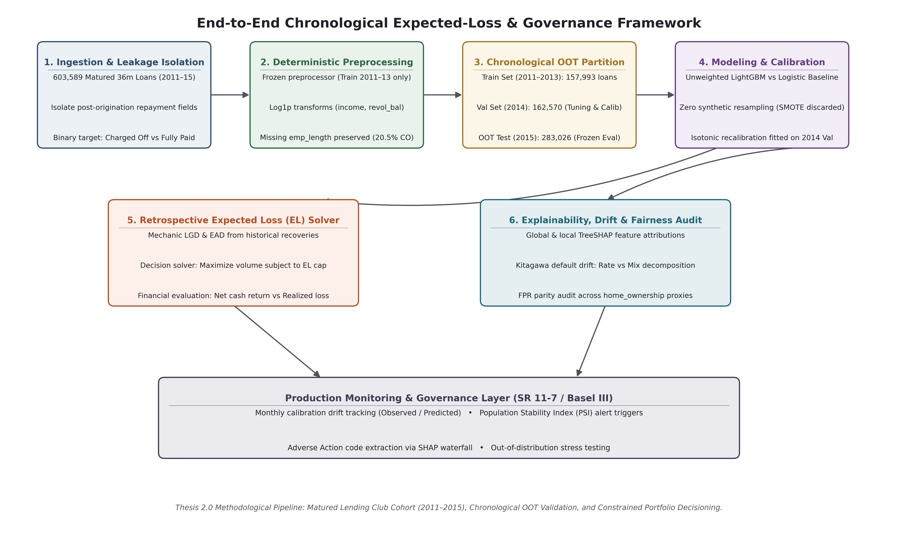
  <br>
  <em>End-to-end chronological Expected-Loss and governance architecture.</em>
</div>

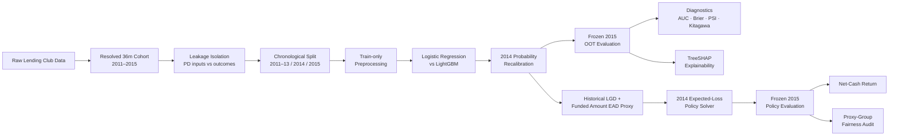

### Core Methodological Safeguards

<details>
<summary><strong>1. Leakage isolation</strong></summary>

Repayment, recovery, and other post-origination outcomes are never used as PD predictors. Separate outcome tables preserve the information needed for retrospective loss and cash-flow evaluation without contaminating model training.

</details>

<details>
<summary><strong>2. Chronological validation</strong></summary>

The project does not randomly mix future and historical loan vintages. Training, development, and test cohorts are separated by issue year to provide a more demanding test of temporal generalization.

</details>

<details>
<summary><strong>3. Training-only preprocessing</strong></summary>

Imputation, scaling, encoding, and feature transformations are fitted using the 2011–2013 training cohort and then carried forward to later cohorts.

</details>

<details>
<summary><strong>4. Frozen probability calibration</strong></summary>

The underlying LightGBM is fitted on 2011–2013. Isotonic calibration is fitted on 2014 and then applied unchanged to 2015. The 2015 cohort is not used to fit the model or recalibrator.

</details>

<details>
<summary><strong>5. Development-stage policy selection</strong></summary>

The Expected Loss boundary is selected using the 2014 development cohort and is frozen before being applied to 2015. The policy analysis is retrospective and should not be interpreted as a live January-2015 deployment because complete 2014 final outcomes would not have been available at that time.

</details>

<details>
<summary><strong>6. Fairness interpretation</strong></summary>

Home ownership is used only as an illustrative socioeconomic proxy. Renter/non-renter comparisons are model-governance diagnostics and do not constitute a protected-class disparate-impact assessment.

</details>

---

## Notebook Workflow

| Phase | Notebook | Purpose | Main artifacts / handoff |
|---|---|---|---|
| **1. Cohort** | `01-Preprocessing.ipynb` | Creates the resolved 36-month cohort, target, leakage-safe PD dataset, and principal-loss outcome table. | `pd_cohort_...parquet`, `loss_outcomes_...parquet` |
| **1b. Payments** | `01b-Payment-Outcomes.ipynb` | Extracts payment, interest, fee, and recovery fields for the same cohort. | `payment_outcomes_...parquet` |
| **2. EDA** | `02-EDA.ipynb` | Examines class balance, cohort evolution, missingness, distributions, and observed charge-off patterns. | EDA tables and figures |
| **3. Features** | `03-Feature-Engineering.ipynb` | Creates deterministic features and fits train-only preprocessing artifacts. | Baseline and pricing preprocessors |
| **4. Modelling** | `04-Population-Stability-and-PD-Modeling.ipynb` | Compares Logistic Regression and LightGBM, evaluates validation calibration, and fits the frozen isotonic challenger. | Raw and calibrated model checkpoints |
| **4b. Diagnostics** | `04b-Model-Diagnostics-and-Drift.ipynb` | Adds bootstrap discrimination CIs, formal calibration diagnostics, alternative recalibration, PSI, Kitagawa decomposition, and monthly drift. | `04b_*.csv`, diagnostic figures |
| **4c. Sensitivity** | `04c-Sensitivity-Feature-Policies.ipynb` | Tests feature removals, proxy-trio removal, delayed labels, lender-pricing reference, and grade-only reference models. | `04c_*.csv`, sensitivity figure |
| **5. EL policy** | `05-Expected-Loss-and-Decision-Framework.ipynb` | Builds the retrospective Expected Loss framework and selects the frozen 2014 policy boundary. | `pd_policy_2014_unweighted_isotonic.json` |
| **5b. Net return** | `05b-Net-Return-Analysis.ipynb` | Compares undiscounted net cash and return on funded amount for accepted, rejected, and accept-all subsets. | Financial evaluation tables |
| **6. Governance** | `06-Explainability-and-Fairness-Auditing.ipynb` | Produces global/local TreeSHAP attribution and the renter/non-renter proxy-group audit. | SHAP and fairness outputs |
| **Figures** | `additional-figures.ipynb` | Produces thesis architecture, timelines, PSI/sensitivity plots, tables, and the final one-page thesis summary. | `reports/figures/` |

<details>
<summary><strong>Notebook dependency notes</strong></summary>

- `01b` must use the same cohort and loan ordering created by `01`.
- `03` freezes preprocessing for downstream modelling.
- `04b` and `04c` extend `04` without redefining the frozen baseline model.
- `05` consumes the calibrated PD model plus the loss-outcome table.
- `05b` additionally consumes the payment-outcomes table produced by `01b`.
- `06` audits the already-frozen model/policy rather than tuning it on the final 2015 cohort.

</details>

---

## Key Results

### 1. Out-of-Time Discrimination

| Model | 2015 ROC-AUC | Gini | KS | 95% bootstrap AUC CI |
|---|---:|---:|---:|---:|
| Logistic Regression | 0.6569 | 0.3139 | 0.2253 | [0.6545, 0.6596] |
| **LightGBM (raw)** | **0.6625** | **0.3251** | **0.2362** | **[0.6598, 0.6655]** |

The LightGBM gain is statistically distinguishable in the bootstrap comparison but modest in absolute magnitude. Ranking performance alone is therefore not treated as sufficient evidence for financial decision quality.

### 2. Probability Calibration

| 2015 diagnostic | Raw LightGBM | 2014-fitted Isotonic |
|---|---:|---:|
| Brier score | 0.1219 | **0.1216** |
| Calibration slope | 1.0160 | 0.9912 |
| Calibration-in-the-large | 0.1762 | **0.1167** |
| Observed / predicted ratio | 1.1570 | **1.1008** |

The principal OOT calibration issue is a shift in the overall risk level rather than a major collapse in ranking.

<details>
<summary><strong>Alternative recalibration result</strong></summary>

Isotonic recalibration improved probability-level alignment, but it did not uniquely dominate simpler alternatives. Intercept-only and Platt recalibration fitted on the same development information produced very similar 2015 Brier/log-loss results, and a Platt specification fitted on the second half of 2014 achieved the lowest reported log loss.

</details>

### 3. Population Stability and Drift

Selected diagnostics:

| Diagnostic | Result | Interpretation |
|---|---:|---|
| `verification_status` PSI | 0.1805 | Moderate shift among baseline model inputs |
| DTI PSI | 0.0638 | Comparatively limited shift |
| Raw LightGBM score PSI, 2014→2015 | 0.0013 | Highly stable score distribution |
| `int_rate` PSI | 0.2945 | Large contextual shift; **not** a baseline model input |

Kitagawa decomposition indicates that the increase in observed charge-off rates was dominated by **within-segment rate deterioration**, rather than a move toward segments that were already higher-risk. This is descriptive and does not identify a causal macroeconomic mechanism.

### 4. Feature-Policy Sensitivity

| Variant | 2015 AUC | Realized principal-loss rate | Renter / non-renter approval ratio | FPR ratio |
|---|---:|---:|---:|---:|
| Baseline | 0.6625 | 5.27% | 0.7521 | 1.8894 |
| No `home_ownership` | 0.6593 | 5.32% | 0.8327 | 1.4977 |
| No proxy trio | 0.6581 | 5.32% | 0.8453 | 1.4497 |

Feature-policy changes can move predictive, financial, and proxy-group outcomes in different directions. These results are sensitivity diagnostics, not causal or legal findings.

<details>
<summary><strong>Structural/reference sensitivity highlights</strong></summary>

- `delayed_labels_2011_2012`: 2015 LightGBM AUC = **0.6459**
- `pricing_reference`: 2015 LightGBM AUC = **0.6831**
- `grade_only_reference`: 2015 AUC = **0.6784**

The pricing and grade references contain lender-generated underwriting information and are therefore contextual references rather than independent application-data challengers.

</details>

### 5. Expected Loss Policy

The retrospective loan-level framework is:

\[
EL_i = PD_i^{cal} \times \overline{LGD} \times EAD_i^{proxy}
\]

with:

- exposure-weighted historical LGD assumption: **50.0541%**
- EAD proxy: original funded amount
- development-period projected principal-loss constraint: **5.00%**
- selected calibrated-PD approval boundary: **0.169611**

The next isotonic PD boundary, `0.173901`, would have admitted a tied group large enough to raise the projected development-period loss rate to **5.0163%**, so `0.169611` is the largest complete feasible boundary under the rule.

#### 2015 OOT policy evaluation

| Metric | Frozen EL Policy | Accept-All |
|---|---:|---:|
| Loans retained | 195,051 | 283,026 |
| Retention rate | 68.92% | 100.00% |
| Funded exposure | $2.607 bn | $3.624 bn |
| Projected loss rate | 4.75% | — |
| Realized principal loss | $137.26 m | $266.90 m |
| Realized principal-loss rate | **5.27%** | **7.36%** |

This is a retrospective portfolio-selection comparison, not evidence of causal loss prevention.

### 6. Undiscounted Net-Cash Return

\[
NetCash_i = TotalPayment_i - CollectionRecoveryFee_i - FundedAmount_i
\]

| 2015 subset | Loans | Net cash | Return on funded amount |
|---|---:|---:|---:|
| EL-policy approved | 195,051 | $187.09 m | **7.18%** |
| EL-policy rejected | 87,975 | $43.18 m | 4.24% |
| Accept-all | 283,026 | $230.27 m | **6.35%** |

The frozen policy produced a higher **return rate** on funded amount, while the accept-all portfolio produced greater **absolute net cash** because it retained all observed loans.

> [!NOTE]
> This is an undiscounted cash-based metric. It excludes funding costs, servicing costs, taxes, economic capital charges, and the time value of money; it is not a complete accounting or economic-profit measure.

### 7. Explainability and Proxy-Group Fairness

TreeSHAP is applied to the underlying raw unweighted LightGBM. Global attribution identifies variables including FICO, annual income, credit inquiries, loan amount, DTI, and revolving-credit measures among the important contributors to fitted model output.

SHAP values explain the **raw LightGBM margin/log-odds scale**. They do not decompose the subsequent isotonic mapping and are not treated as legally sufficient adverse-action reasons.

#### Frozen 2015 proxy-group decision metrics

| Metric | Non-renters | Renters |
|---|---:|---:|
| Loans | 161,563 | 121,463 |
| Observed charge-off rate | 12.80% | 17.65% |
| Simulated rejection rate | 22.88% | 42.00% |
| FPR | 20.38% | 38.50% |
| 95% Wilson CI for FPR | [20.17%, 20.59%] | [38.20%, 38.81%] |
| FNR | 60.11% | 41.69% |
| TPR | 39.89% | 58.31% |

**Renter / non-renter FPR ratio: 1.8895**

The audit identifies different simulated error allocations across the two socioeconomic proxy groups. It does **not** independently establish unlawful discrimination, protected-class disparate impact, or fair-lending non-compliance.

---

## Visualizations and Output Gallery

The publication figures used by the project are stored in [`reports/figures/`](reports/figures/).

### Thesis at a Glance

<div align="center">
  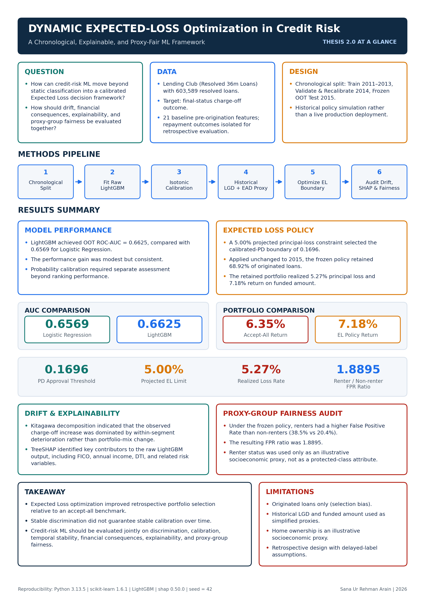
  <br>
  <em>One-page summary of the research question, chronological pipeline, principal results, governance diagnostics, and limitations.</em>
</div>

<details>
<summary><strong>📊 Open the full figure gallery</strong></summary>

<br>

<table>
<tr>
<td width="50%" align="center">
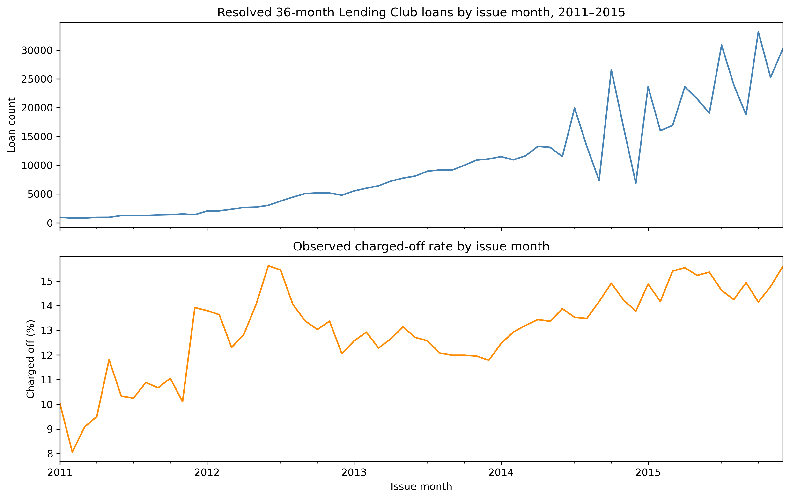
<br><b>Longitudinal cohort evolution</b><br>
<sub>Resolved-loan volume and observed charge-off rate across 2011–2015.</sub>
</td>
<td width="50%" align="center">
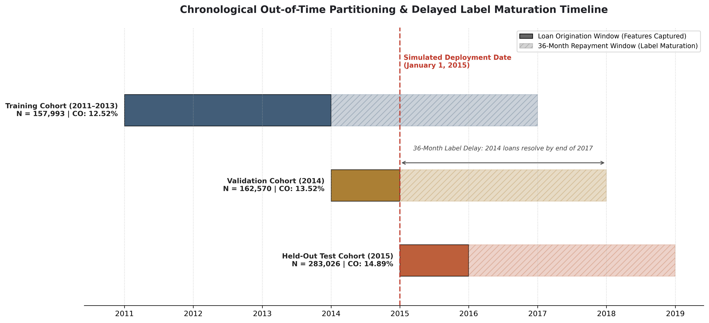
<br><b>Chronological OOT design</b><br>
<sub>Training, validation/recalibration, final OOT evaluation, and delayed-label maturation.</sub>
</td>
</tr>

<tr>
<td align="center">
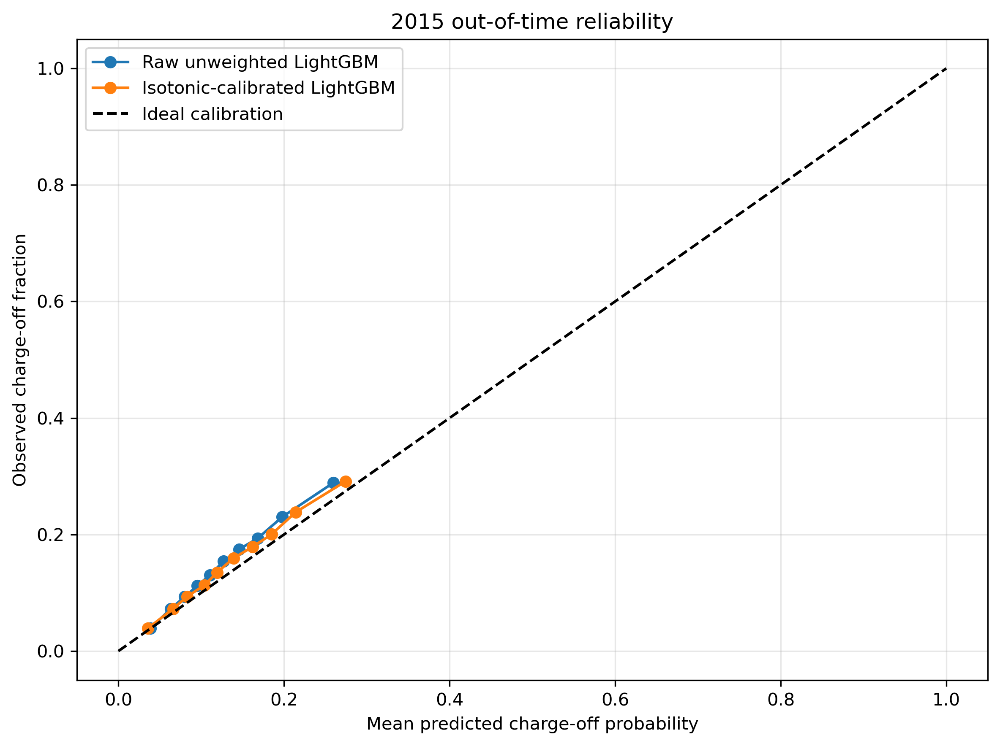
<br><b>2014 validation reliability</b><br>
<sub>Observed charge-off frequency versus raw predicted probabilities before OOT application.</sub>
</td>
<td align="center">

<br><b>2015 OOT reliability</b><br>
<sub>Raw versus frozen isotonic probability alignment on the held-out 2015 cohort.</sub>
</td>
</tr>

<tr>
<td align="center">
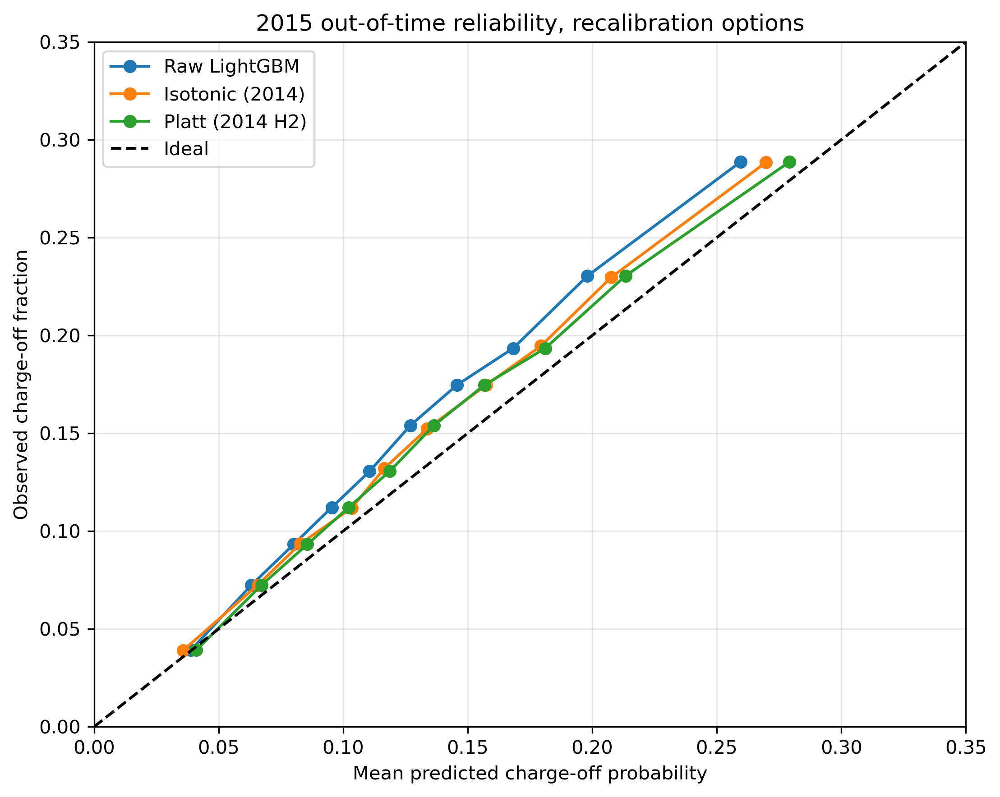
<br><b>Alternative recalibration comparison</b><br>
<sub>2015 reliability diagnostics for the alternative recalibration specifications.</sub>
</td>
<td align="center">
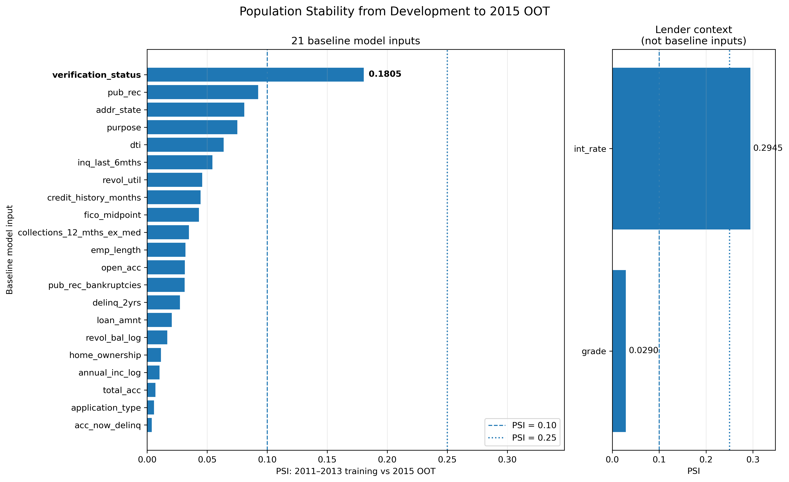
<br><b>Population Stability Index</b><br>
<sub>PSI across the 21 baseline inputs, with lender-context variables shown separately.</sub>
</td>
</tr>

<tr>
<td align="center">
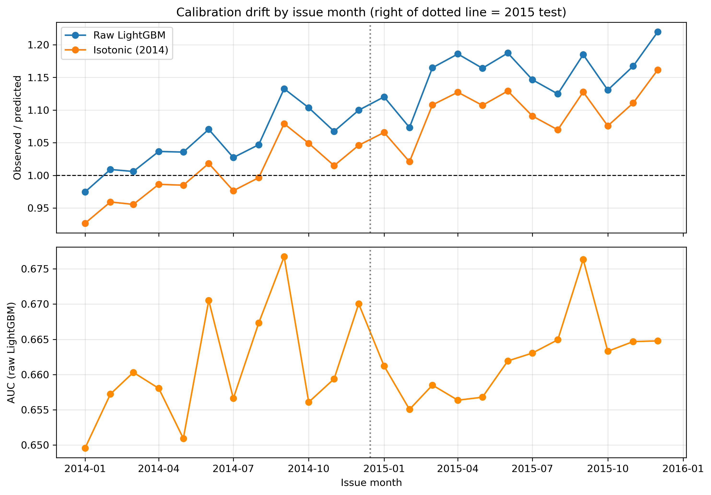
<br><b>Monthly discrimination and calibration drift</b><br>
<sub>Ranking performance remains broadly stable while probability-level alignment deteriorates.</sub>
</td>
<td align="center">
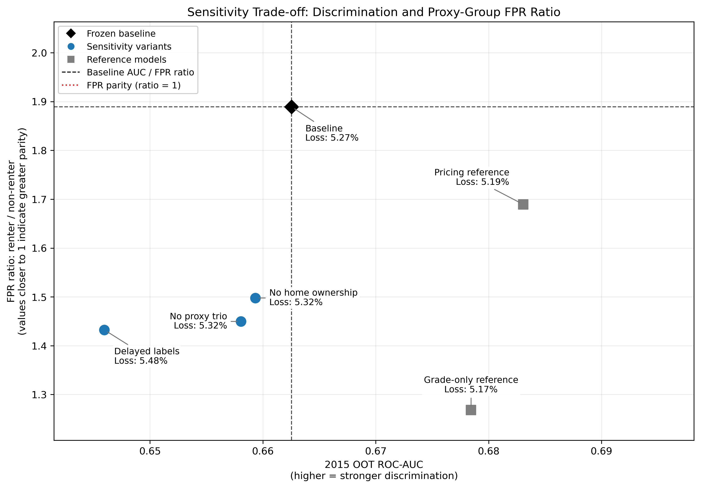
<br><b>Feature-policy sensitivity trade-off</b><br>
<sub>2015 ROC-AUC versus renter/non-renter FPR ratio across selected variants.</sub>
</td>
</tr>

<tr>
<td align="center">
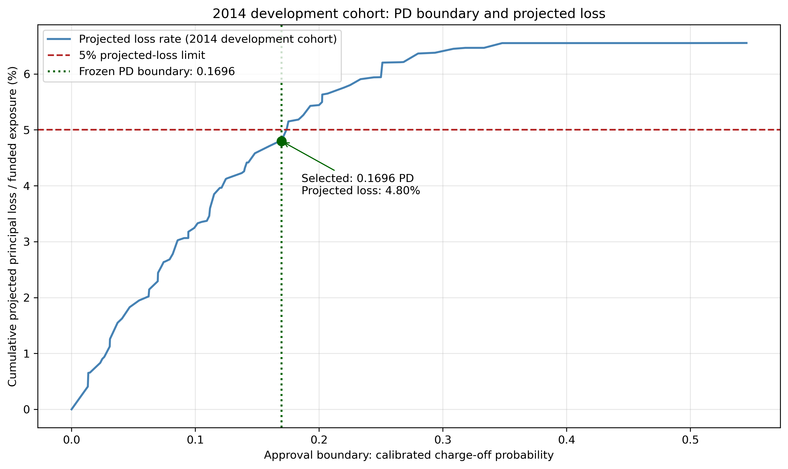
<br><b>2014 Expected Loss policy curve</b><br>
<sub>Largest feasible calibrated-PD approval boundary under the 5.00% projected loss constraint.</sub>
</td>
<td align="center">
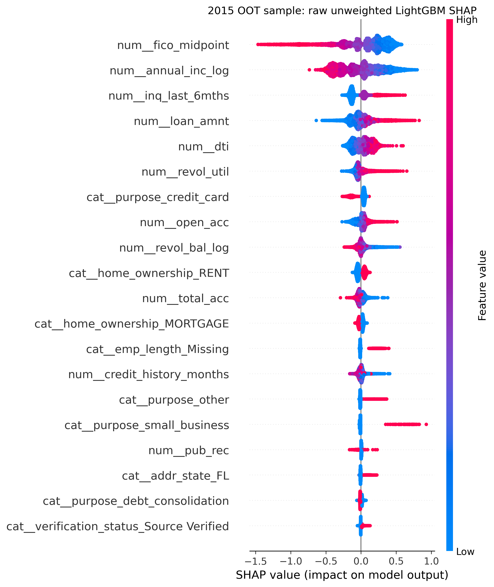
<br><b>Global TreeSHAP attribution</b><br>
<sub>Feature contributions to the underlying raw LightGBM output on a reproducible 2015 sample.</sub>
</td>
</tr>

<tr>
<td align="center">
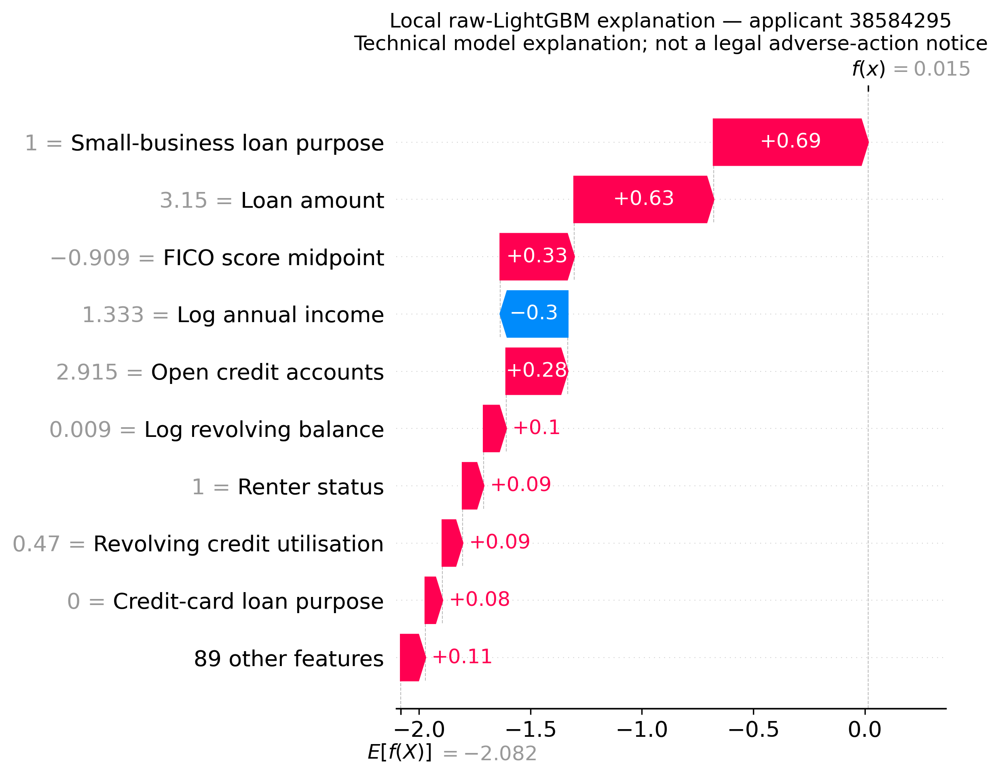
<br><b>Local TreeSHAP explanation</b><br>
<sub>Technical attribution for a reproducibly selected rejected observation; calibration is reported separately.</sub>
</td>
<td align="center">
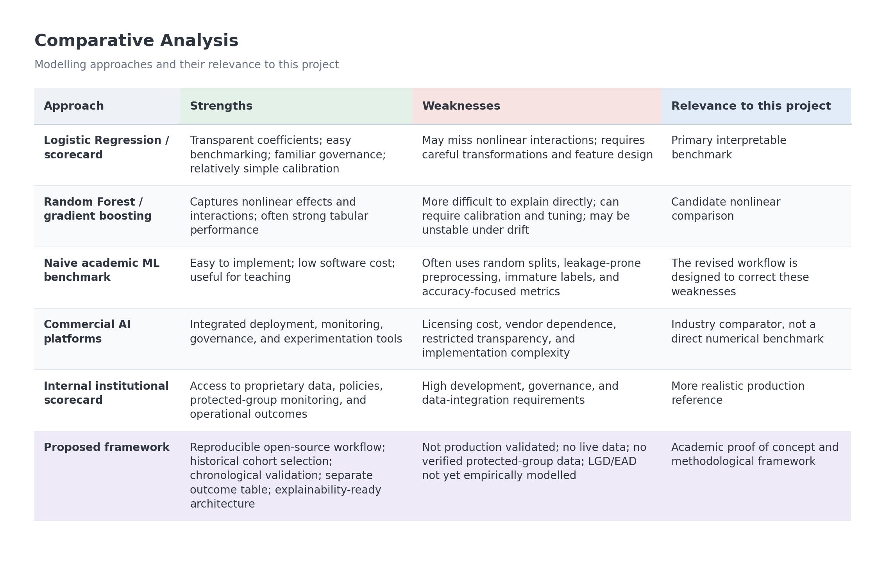
<br><b>Comparative methodology table</b><br>
<sub>Positioning of the proposed research framework against alternative credit-risk approaches.</sub>
</td>
</tr>

<tr>
<td align="center">
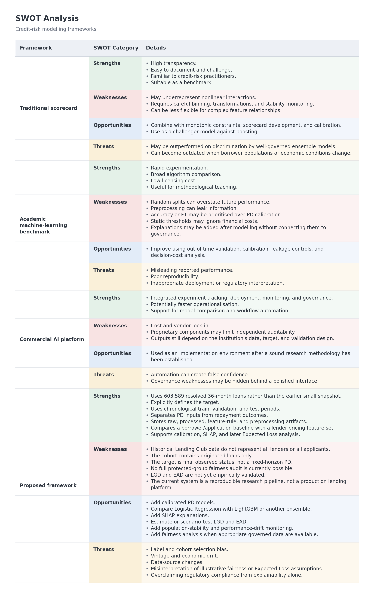
<br><b>SWOT analysis</b><br>
<sub>Strengths, weaknesses, opportunities, and threats across credit-risk modelling approaches.</sub>
</td>
<td align="center">
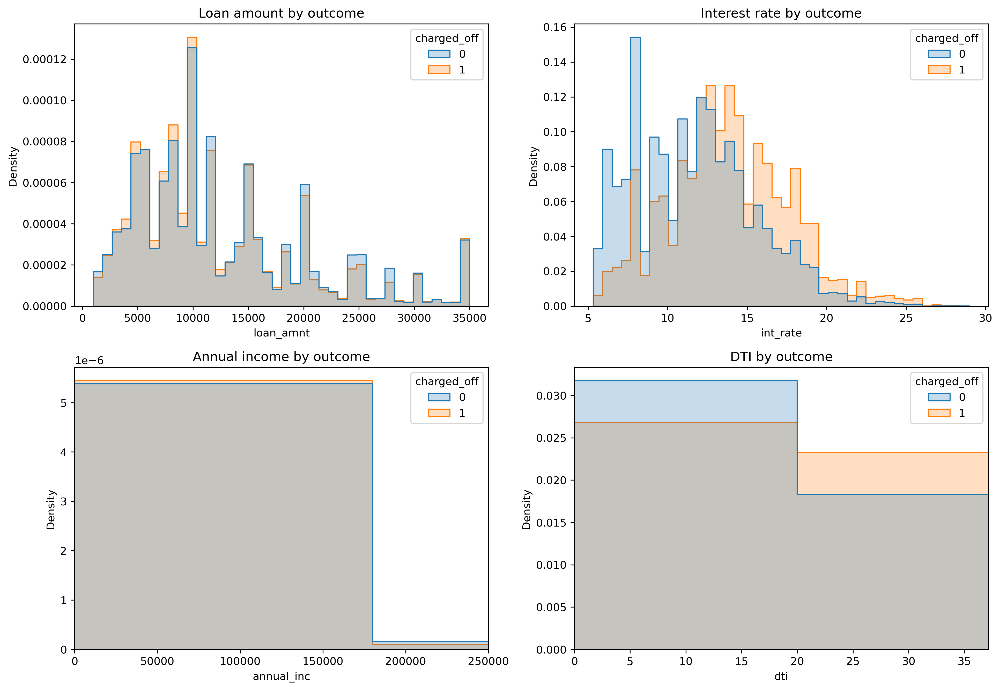
<br><b>Exploratory feature distributions</b><br>
<sub>Representative EDA supporting deterministic feature transformations.</sub>
</td>
</tr>
</table>

</details>

<details>
<summary><strong>Available figure files</strong></summary>

```text
reports/figures/
├── 04b_monthly_drift_2014_2015.png
├── 04b_psi_model_inputs_and_context.png
├── 04b_reliability_recalibration_2015.png
├── 04c_sensitivity_auc_vs_fpr_ratio.png
├── chronological_oot_timeline.png
├── comparative_table.pdf
├── comparative_table.png
├── development_policy_curve_2014_unweighted_isotonic.png
├── histplot01.png
├── histplot02.png
├── monthly_loan_volume_and_observed_charged_off_rate.png
├── oot_reliability_unweighted_isotonic_2015.png
├── Project_Cover_16x9_V2.png
├── shap_global_unweighted_lightgbm_2015.png
├── shap_local_model_explanation_2015_readable.png
├── swot_table.pdf
├── swot_table.png
├── thesis_2_at_a_glance_v2.pdf
├── thesis_2_at_a_glance_v2.png
├── thesis_2_at_a_glance_v2.svg
├── thesis_2_pipeline_architecture.png
└── validation_reliability_unweighted_2014.png
```

</details>

---

## Repository Structure

<details>
<summary><strong>📂 Expand full project tree</strong></summary>

```text
dynamic-credit-risk-xai/
├── data/
│   ├── external/
│   ├── processed/
│   │   ├── loss_outcomes_2011_2015_36m.parquet
│   │   ├── payment_outcomes_2011_2015_36m.parquet
│   │   └── pd_cohort_2011_2015_36m.parquet
│   └── raw/
│       └── accepted_2007_to_2018Q4.csv.gz
│
├── models/
│   ├── checkpoints/
│   │   ├── baseline_preprocessor_2011_2013.joblib
│   │   ├── calibrated_lightgbm_unweighted_isotonic.joblib
│   │   ├── lightgbm_challenger_unweighted.joblib
│   │   ├── pd_policy_2014_unweighted_isotonic.json
│   │   └── pricing_preprocessor_2011_2013_unused.joblib
│   └── saved_agents/
│
├── notebooks-&-codes/
│   ├── 01-Preprocessing.ipynb
│   ├── 01b-Payment-Outcomes.ipynb
│   ├── 02-EDA.ipynb
│   ├── 03-Feature-Engineering.ipynb
│   ├── 04-Population-Stability-and-PD-Modeling.ipynb
│   ├── 04b-Model-Diagnostics-and-Drift.ipynb
│   ├── 04c-Sensitivity-Feature-Policies.ipynb
│   ├── 05-Expected-Loss-and-Decision-Framework.ipynb
│   ├── 05b-Net-Return-Analysis.ipynb
│   ├── 06-Explainability-and-Fairness-Auditing.ipynb
│   └── additional-figures.ipynb
│
├── planning/
│   └── prob_stat-lit_rev-comp_analysis.pdf
│
├── reports/
│   ├── figures/
│   │   ├── 04b_monthly_drift_2014_2015.png
│   │   ├── 04b_psi_model_inputs_and_context.png
│   │   ├── 04b_reliability_recalibration_2015.png
│   │   ├── 04c_sensitivity_auc_vs_fpr_ratio.png
│   │   ├── chronological_oot_timeline.png
│   │   ├── comparative_table.pdf
│   │   ├── comparative_table.png
│   │   ├── development_policy_curve_2014_unweighted_isotonic.png
│   │   ├── histplot01.png
│   │   ├── histplot02.png
│   │   ├── monthly_loan_volume_and_observed_charged_off_rate.png
│   │   ├── oot_reliability_unweighted_isotonic_2015.png
│   │   ├── Project_Cover_16x9_V2.png
│   │   ├── shap_global_unweighted_lightgbm_2015.png
│   │   ├── shap_local_model_explanation_2015_readable.png
│   │   ├── swot_table.pdf
│   │   ├── swot_table.png
│   │   ├── thesis_2_at_a_glance_v2.pdf
│   │   ├── thesis_2_at_a_glance_v2.png
│   │   ├── thesis_2_at_a_glance_v2.svg
│   │   ├── thesis_2_pipeline_architecture.png
│   │   └── validation_reliability_unweighted_2014.png
│   │
│   ├── logs/
│   │
│   └── tables/
│       ├── 04b_auc_bootstrap_ci_2015.csv
│       ├── 04b_calibration_summary.csv
│       ├── 04b_discrimination.csv
│       ├── 04b_drift_decomposition.csv
│       ├── 04b_monthly_drift.csv
│       ├── 04b_psi_model_inputs.csv
│       ├── 04b_psi_score.csv
│       ├── 04b_recalibration_alternatives_2015.csv
│       ├── 04c_variant_model_quality.csv
│       └── 04c_variant_policy_outcomes.csv
│
├── src/
│   ├── data/
│   ├── env/
│   ├── features/
│   ├── models/
│   └── utils/
│
├── tests/
├── .gitattributes
├── .gitignore
├── CITATION.cff
├── LICENSE
├── README.md
├── requirements.txt
└── TASKS.md
```

</details>

The tree intentionally omits the local `archive/` directory, Word documents, and working text notes.

---

## Reports and Machine-Readable Outputs

<details>
<summary><strong>📋 Diagnostic CSV outputs</strong></summary>

| File | Contents |
|---|---|
| `04b_auc_bootstrap_ci_2015.csv` | Bootstrap AUC confidence intervals / paired discrimination results |
| `04b_calibration_summary.csv` | Calibration slope, calibration-in-the-large and related diagnostics |
| `04b_discrimination.csv` | OOT discrimination metrics |
| `04b_drift_decomposition.csv` | Kitagawa rate/mix decompositions |
| `04b_monthly_drift.csv` | Monthly discrimination and calibration tracking |
| `04b_psi_model_inputs.csv` | PSI across baseline inputs |
| `04b_psi_score.csv` | Model-score PSI |
| `04b_recalibration_alternatives_2015.csv` | Alternative recalibration comparisons |
| `04c_variant_model_quality.csv` | Predictive quality across feature-policy variants |
| `04c_variant_policy_outcomes.csv` | Policy, loss and proxy-group outcomes across variants |

</details>

<details>
<summary><strong>💾 Frozen model/policy artifacts</strong></summary>

| Artifact | Purpose |
|---|---|
| `baseline_preprocessor_2011_2013.joblib` | Frozen baseline preprocessor learned only from training vintages |
| `lightgbm_challenger_unweighted.joblib` | Underlying unweighted LightGBM challenger |
| `calibrated_lightgbm_unweighted_isotonic.joblib` | Frozen isotonic-calibrated challenger |
| `pd_policy_2014_unweighted_isotonic.json` | Frozen development-stage approval policy |
| `pricing_preprocessor_2011_2013_unused.joblib` | Lender-pricing reference preprocessing artifact |

</details>

---

## How to Run

### 1. Clone the repository

```bash
git clone https://github.com/sanaurrehmanarain/dynamic-credit-risk-xai.git
cd dynamic-credit-risk-xai
```

### 2. Create a local environment

```bash
python -m venv .venv
```

Activate it:

```bash
# Windows
.venv\Scripts\activate
```

```bash
# macOS / Linux
source .venv/bin/activate
```

### 3. Install dependencies

```bash
python -m pip install --upgrade pip
pip install -r requirements.txt
```

### 4. Add the raw Lending Club dataset

Place:

```text
accepted_2007_to_2018Q4.csv.gz
```

inside:

```text
data/raw/
```

### 5. Run the notebooks in order

```text
01-Preprocessing.ipynb
01b-Payment-Outcomes.ipynb
02-EDA.ipynb
03-Feature-Engineering.ipynb
04-Population-Stability-and-PD-Modeling.ipynb
04b-Model-Diagnostics-and-Drift.ipynb
04c-Sensitivity-Feature-Policies.ipynb
05-Expected-Loss-and-Decision-Framework.ipynb
05b-Net-Return-Analysis.ipynb
06-Explainability-and-Fairness-Auditing.ipynb
additional-figures.ipynb
```

You can run the notebooks directly in **VS Code** or launch Jupyter Lab:

```bash
jupyter lab
```

<details>
<summary><strong>Recommended reproduction strategy</strong></summary>

For a clean end-to-end reproduction:

1. Start from the raw `.csv.gz`.
2. Delete or move existing generated `data/processed/`, model checkpoints, and report outputs if you want to verify regeneration from scratch.
3. Run notebooks in the sequence above.
4. Do not modify frozen artifacts between `04`, `05`, and `06`.
5. Compare regenerated CSV diagnostics against the files in `reports/tables/`.
6. Regenerate the final figure suite with `additional-figures.ipynb`.

</details>

---

## Reproducibility

The project uses deterministic seeds where applicable:

```text
random_state = 42
```

Key reproducibility choices include:

- fixed chronological partition definitions;
- preprocessing fitted only on the training period;
- saved model and calibration artifacts;
- a frozen JSON policy rule;
- reproducible SHAP sampling;
- machine-readable diagnostic CSV outputs; and
- programmatically generated thesis figures.

> [!TIP]
> For the closest replication of the submitted research, use the package versions pinned in `requirements.txt` rather than installing unpinned latest releases.

<details>
<summary><strong>🧾 Reporting checklist for future updates</strong></summary>

When updating notebooks, figures, tables, or manuscript text, preserve the following interpretation rules:

- **Cohort and target:** Define the study population as originated, resolved 36-month Lending Club loans with final status `Fully Paid` or `Charged Off`. Treat `charged_off = 1` as the recorded final-status charge-off outcome, not as a fixed-horizon regulatory PD or time-to-default measure.
- **Feature timing:** Keep post-origination repayment variables out of PD modelling. The timing of some historical predictors, particularly `verification_status`, is not independently verified at the exact approval decision point and should be described as a modelling assumption.
- **Observed vs predicted risk:** In Results, figures, and captions, distinguish clearly between observed charge-off rates and predicted or calibrated charge-off probabilities.
- **Expected Loss interpretation:** Treat the 5.00% EL constraint as a projected development-stage portfolio limit, not as a guaranteed cap on realized future losses.
- **Scope and deployment:** Reiterate that the analysis is retrospective, limited to originated and resolved loans, and is not a validated production underwriting system.
- **Fairness interpretation:** Renter/non-renter comparisons are proxy-group governance diagnostics, not a protected-class disparate-impact determination.

</details>

---

## Limitations

<details>
<summary><strong>Expand methodological limitations</strong></summary>

- **Originated-loan selection bias.** Repayment outcomes are observed only for loans that Lending Club actually originated; rejected applicants cannot be evaluated.
- **Final-status target.** The outcome is Fully Paid versus Charged Off after resolution, not a fixed-horizon regulatory PD.
- **Delayed labels.** Fully resolved 36-month outcomes introduce a maturity delay that prevents the 2014 recalibration experiment from representing an exact January-2015 live deployment.
- **Feature availability.** Historical feature availability at the precise lending-decision timestamp is assumed for the modelling inputs and cannot be fully verified for every field.
- **Simplified LGD/EAD.** Historical loss severity and original funded amount are used as retrospective proxies rather than independently estimated production LGD/EAD models.
- **Undiscounted financial metric.** Net-return calculations omit funding cost, servicing cost, taxes, capital charges, and time value of money.
- **Calibration transport.** A mapping fitted on one historical cohort may not preserve probability alignment as later risk levels change.
- **SHAP scope.** TreeSHAP explains the raw LightGBM model, not the isotonic mapping, and does not by itself provide legally sufficient adverse-action reason codes.
- **Fairness scope.** Home ownership is an illustrative socioeconomic proxy, not a protected-class label; the renter/non-renter audit is not a formal disparate-impact determination.
- **Single data source.** Lending Club vintages do not represent all lenders, products, underwriting systems, or borrower populations.

</details>

---

## Conclusion

This project extends credit-risk machine learning from a static ranking exercise into a broader historical decision-analysis framework. The empirical results show that a modest improvement in OOT discrimination does not remove the need to evaluate **calibration, temporal stability, loss consequences, and governance**.

The Expected Loss experiment illustrates how a frozen calibrated-PD policy can select a historically lower-loss subset and improve return on funded amount relative to an accept-all benchmark, while the drift and proxy-group diagnostics show why those financial results cannot be interpreted independently of model stability and decision-allocation effects.

The central takeaway is therefore methodological:

> **Credit-risk ML should be evaluated as a complete decision system, not only as a classifier.**

---

## Dataset

**Historical Lending Club accepted-loans data (2007–2018Q4)**  
Hosted on Kaggle by *wordsforthewise*:

https://www.kaggle.com/datasets/wordsforthewise/lending-club

The repository analyses a filtered, fully resolved 2011–2015 36-month cohort for academic research. Users should review the original dataset terms before redistribution.

---

## Citation

If you use, adapt, or build upon this repository in academic work, please cite it and provide attribution.

> A [`CITATION.cff`](CITATION.cff) file is included so GitHub can expose ready-made citation formats through **Cite this repository**.

### Suggested Citation

> Arain, S. U. R. (2026). *Dynamic Expected-Loss Optimization in Credit Risk: An Explainable and Fair Machine-Learning Framework* (Version 1.0) [Software]. https://github.com/sanaurrehmanarain/dynamic-credit-risk-xai

<details>
<summary><strong>BibTeX</strong></summary>

```bibtex
@software{arain2026dynamiccreditrisk,
  author  = {Arain, Sana Ur Rehman},
  title   = {Dynamic Expected-Loss Optimization in Credit Risk: An Explainable and Fair Machine-Learning Framework},
  year    = {2026},
  version = {1.0},
  url     = {https://github.com/sanaurrehmanarain/dynamic-credit-risk-xai}
}
```

</details>

---

## License

© 2026 Sana Ur Rehman Arain.

This project is licensed under the **MIT License**. See [`LICENSE`](LICENSE) for the complete terms.

The Lending Club dataset is an external data source and is not covered by this repository's MIT license.

---

## Author

<table>
  <tr>
    <td><b>Author</b></td>
    <td>Sana Ur Rehman Arain</td>
    <td rowspan="4" align="center" width="180">
      
    </td>
  </tr>
  <tr>
    <td><b>Role</b></td>
    <td>Data Scientist</td>
  </tr>
  <tr>
    <td><b>GitHub</b></td>
    <td><a href="https://github.com/sanaurrehmanarain">@sanaurrehmanarain</a></td>
  </tr>
  <tr>
    <td><b>Contact</b></td>
    <td><a href="mailto:sana.arain.work@gmail.com">sana.arain.work@gmail.com</a></td>
  </tr>
</table>

---

<div align="center">

**Part II of the credit-risk modelling research series**

*Classification → Calibration → Chronological Validation → Expected Loss → Model Governance*

⭐ If you find this repository useful, consider giving it a star.

</div>
